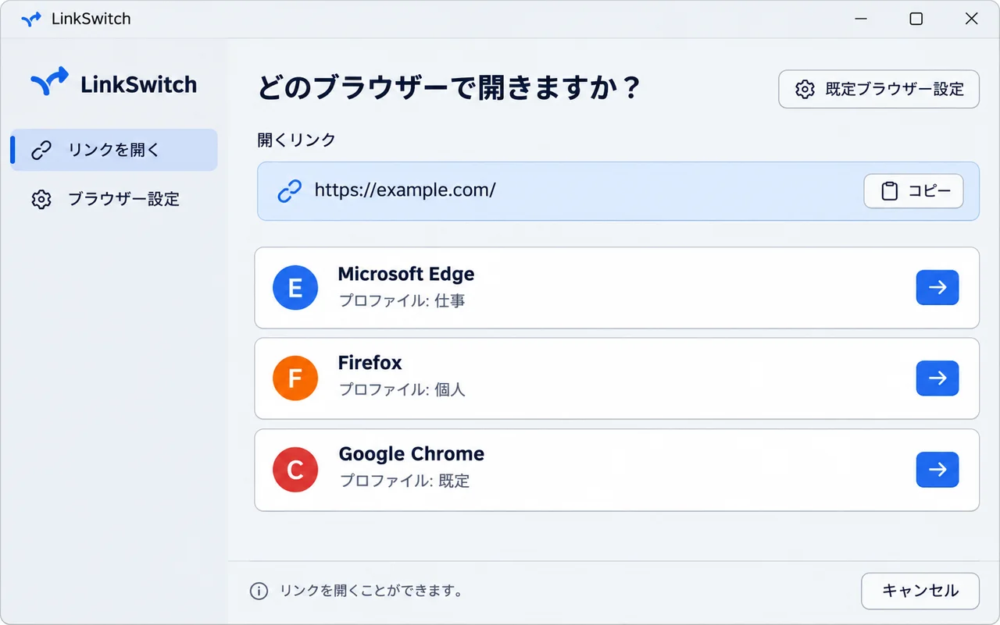

# LinkSwitch

Windowsでリンクをクリックしたときに、**どのブラウザー・プロファイルで開くかを選ぶ**アプリです。リンク先を表示するブラウザー本体は内蔵していません。Go と Win32 API で作っており、別途ランタイムを入れる必要はありません。

## 使い方

1. [Releases](../../releases/latest) から、Windows のシステムの種類に合う `LinkSwitch-windows-amd64.exe`（Intel / AMD の64ビットPC）または `LinkSwitch-windows-arm64.exe`（ARM64 PC）をダウンロードします。Windows 11 を対象としています。実行ファイルにコード署名は付いていません。必要なら `SHA256SUMS.txt` と PowerShell の `Get-FileHash` で照合してください。
2. ダウンロードした EXE を、今後も置いておくフォルダーへ移してから起動します。
3. **ブラウザー設定**で起動先を追加します。同じ EXE を違う名前・引数で複数登録できます。ブラウザーは別途インストールしてください。
4. **既定ブラウザー設定**から LinkSwitch を登録し、Windows の **設定 → アプリ → 既定のアプリ → LinkSwitch** で、`HTTP` と `HTTPS` の既定を LinkSwitch に変更します。LinkSwitch は Windows の既定値を勝手に変更しません。
5. 別のアプリでリンクを開き、LinkSwitch の一覧から起動先を選びます。キャンセルすれば、どのブラウザーも起動しません。既存のブラウザー内のリンクなど、Windows の既定関連付けを経由しないリンクには介入しません。

## 引数

引数欄には **一行に一つ**、外側の引用符は付けずに入力します。例えば Chromium 系のブラウザーで仕事用プロファイルを開く場合：

```text
--profile-directory=Profile 1
{url}
```

- `{url}` がなければ URL を末尾に一引数として追加します。
- プロファイルの識別子と引数は、ブラウザーの仕様に従ってください。上の `Profile 1` は例です。
- URL は HTTP / HTTPS のみ受け付け、指定の実行ファイルに引数として渡します。シェルは介しません。信頼できるブラウザーの EXE と引数だけを登録してください。

設定は `%LOCALAPPDATA%\LinkSwitch\config.json` に保存します。アプリはリンク履歴を保存せず、通信もしません。実行ファイルを移動した場合は、移動後にもう一度登録してください。利用をやめるには Windows の既定を別のブラウザーへ戻してから、LinkSwitch 側で登録を解除します。

## ビルド

Go 1.27.4 で検証。Windows の PowerShell で以下を実行すると、`dist` に amd64 / arm64 の GUI EXE と SHA-256 一覧ができます。

```powershell
go test ./...
go vet ./...
./scripts/build.ps1
```

UI は画像生成で作成したデザイン案を元に、左サイドバー、青い URL 欄、ブラウザーごとの起動行を Win32 コントロールとして実装しています。



Linux / macOS から同じ Windows 用バイナリをクロスビルドする場合は `sh scripts/build.sh` を実行します。Windows 以外で動くアプリは生成しません。

同梱される Go ランタイム・標準ライブラリのライセンスは [Go のライセンス](docs/GO-LICENSE.txt) を参照してください。

## CI リリース

GitHub の **Actions → Release LinkSwitch → Run workflow** を開き、ブランチ `main` と未使用のバージョン（例: `v0.1.2`）を指定し、公開する場合は publish をオンにします。Windows CI がソースをテストし、amd64・arm64 の EXE と SHA-256 一覧を GitHub Releases に登録します。既存リリースは上書きしません。

## Scoop

既に Scoop bucket を追加済みなら、PowerShell で次を実行します。

```powershell
scoop update
scoop install sh4869221b/linkswitch
```

未追加の場合は、先に `scoop bucket add sh4869221b https://github.com/sh4869221b/scoop-bucket` を実行してください。

Scoop はインストール時に Windows の既定アプリを変更しません。インストール後、LinkSwitch の **既定ブラウザー設定**で登録を行ってください。Scoop の `current` が有効な通常構成なら、更新後も同じ登録パスが使われます。
